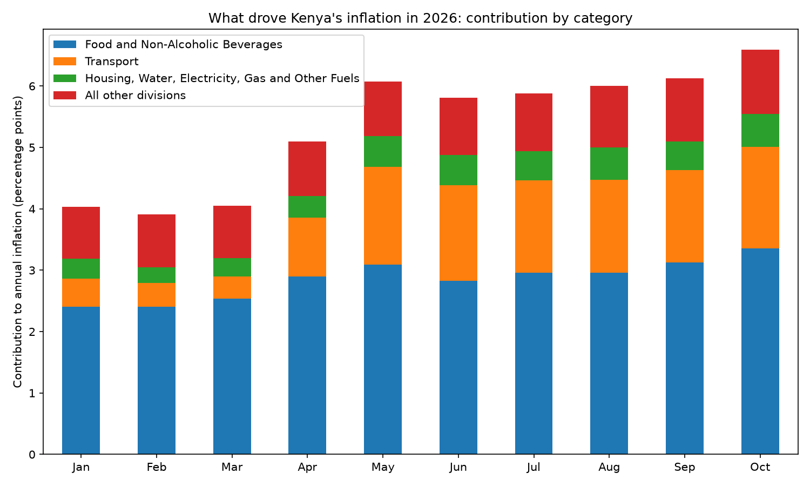

# What drove Kenya's inflation in 2026?

An analysis of Kenya National Bureau of Statistics (KNBS) Consumer Price Index reports, January to October 2026, to find which spending categories pushed inflation up and when.

## Key findings

- Annual inflation rose from 4.4% in January to 7.3% in October 2026.
- **Two phases.** Transport prices jumped 6.5% in April and 6.1% in May after being flat or falling in the first quarter, taking annual transport inflation from 3.8% in March to 16.5% in May. From June onward, rising food prices drove further increases.
- **Food and transport dominate.** In October, food and non-alcoholic beverages contributed about 3.4 percentage points and transport about 1.65, together roughly 5 of the 6.6 points explained by the 13 categories.

## Data

Monthly *Kenya Consumer Price Indices and Inflation Rates* reports from KNBS (January to October 2026). Table 1 of each report gives, for the 13 spending divisions, the basket weight, the monthly change and the annual change. The PDFs are in `data/`, and the cleaned dataset is `data/cpi_divisions_2026.csv`. The CPI base period is February 2019.

## Method

1. Extracted Table 1 from each PDF with `pdfplumber` and combined the ten months (140 rows).
2. Checked that division names and weights were consistent across months.
3. Calculated each division's contribution to annual inflation: `weight x annual change / 100`.
4. Plotted contributions by month for food, transport, housing and utilities, and all other divisions.

## Limitations

- KNBS weights are fixed from the base period. Categories whose prices rose fastest (food, transport) now take up a larger share of spending than their published weight, so this method understates them. In October the contributions sum to 6.59 against the published headline of 7.3.
- The data shows when and by how much prices rose, not why. KNBS and press reports link the transport rise to fuel costs, but this analysis does not test that.

## Tools

Python, pandas, pdfplumber, matplotlib, Jupyter.

## Files

- `kenya_inflation_analysis.ipynb`: full analysis
- `contributions_by_month.png`: main chart
- `data/`: source reports and cleaned dataset

*Author: Antonette Kuvuna*
